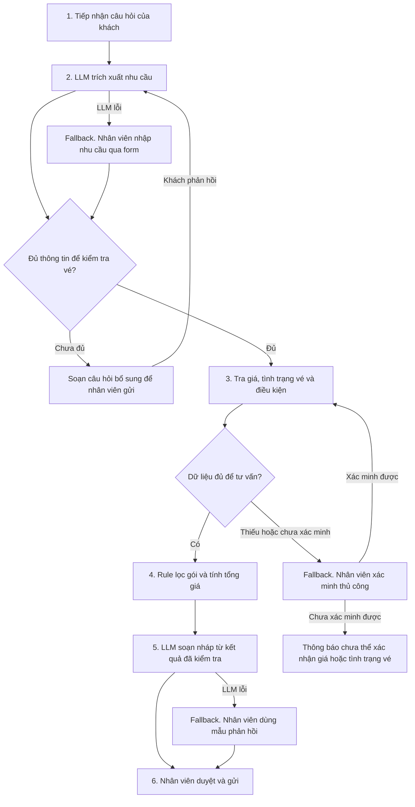

## Phase 3 — Chọn bài toán để thực hiện Deep-Dive

Mình quyết định chọn **Card #3 — Vinpearl: Tư vấn vé và gói vui chơi theo nhu cầu** để thực hiện Deep-Dive.

#### Lý do lựa chọn và loại bỏ các thẻ khác

- **Chọn Card #3 — Vinpearl.** Bài toán có phạm vi rõ ở khâu tư vấn trước khi đặt vé và tác động trực tiếp đến trải nghiệm khách hàng. Nhóm có thể so sánh form rule-based với trợ lý hội thoại trên cùng bộ quy tắc kiểm tra giá, tình trạng vé và điều kiện áp dụng. Cách thử này giúp đo liệu AI có giảm số lượt hỏi lại và thời gian tư vấn khi khách mô tả nhu cầu bằng ngôn ngữ tự nhiên hay không. Điều kiện để thí điểm là có nguồn dữ liệu giá, tình trạng vé và điều kiện áp dụng đủ tin cậy.

- **Loại Card #1 — Vingroup: Trợ lý ảo cho nhân viên mới.** Phạm vi cấp tập đoàn đòi hỏi xác minh tài liệu nào đang có hiệu lực, áp dụng cho đơn vị nào và nhân viên nào được quyền xem. Đồng thời, nhiều câu hỏi lặp lại về biểu mẫu hoặc đầu mối có thể được xử lý bằng danh mục tra cứu theo đơn vị và vai trò. Nhóm cần đo xem bao nhiêu yêu cầu thực sự cần tổng hợp nhiều tài liệu để xác định giá trị tăng thêm của LLM + RAG.

- **Loại Card #2 — VinFast: Tìm phụ tùng cho xe đang sửa.** Hiệu quả phụ thuộc vào dữ liệu tồn kho có thể cấp sau khi trừ hàng đã giữ chỗ, danh mục mã thay thế đã duyệt và lịch điều chuyển đáng tin cậy. Khi các dữ liệu này đủ tốt, rule-based đã có thể lọc mã tương thích, loại kho thiếu hàng và xếp hạng nguồn cấp theo thời điểm giao dự kiến. Nếu xe chậm sửa vì hết hàng hoặc chờ vận chuyển, rút ngắn thời gian tra cứu chỉ cải thiện một phần của quy trình.

### 3.1. Current-State Workflow
Quy trình tư vấn vé và gói vui chơi tại Vinpearl, từ lúc tiếp nhận câu hỏi đến lúc gửi phương án cho khách. Đây là luồng giả định cho **lượt tư vấn cần đối chiếu nhiều điều kiện**, với tổng thời gian xử lý thủ công là **6 phút/lượt** theo Card #3.

```text
┌─────────────────────────┐    ┌─────────────────────────┐
│ Bước 1                  │    │ Bước 2                  │
│ Tiếp nhận câu hỏi       │    │ Làm rõ nhu cầu          │
│                         │    │                         │
│ Ai: Nhân viên tư vấn    │    │ Ai: Nhân viên tư vấn    │
│ ⏱ 0,5 phút              │───▶│ ⏱ 1 phút                │
│ In: Tin nhắn của khách  │    │ In: Nhu cầu ban đầu     │
│ Out: Nhu cầu ban đầu    │    │ Out: Ngày đi, điểm đến, │
│                         │    │ nhóm khách, ngân sách   │
└─────────────────────────┘    └────────────┬────────────┘
                                            │
                                            ▼
┌─────────────────────────┐    ┌─────────────────────────┐
│ Bước 4                  │    │ Bước 3                  │
│ So sánh và tính tổng giá│    │ Tra giá, vé, điều kiện  │
│                         │    │                         │
│ Ai: Nhân viên tư vấn    │    │ Ai: Nhân viên tư vấn    │
│ ⏱ 1,5 phút 🔴            │◀───│ ⏱ 2,5 phút 🔴            │
│ In: Các gói hợp lệ      │    │ In: Thông tin nhóm khách│
│ Out: Phương án phù hợp  │    │ Out: Các gói hợp lệ     │
│ và tổng giá cho cả nhóm│    │ kèm giá từng hạng vé    │
└────────────┬────────────┘    └─────────────────────────┘
             │
             ▼
┌─────────────────────────┐
│ Bước 5                  │
│ Gửi phương án cho khách │
│                         │
│ Ai: Nhân viên tư vấn    │
│ ⏱ 0,5 phút              │
│ In: Phương án đã so sánh│
│ Out: Tin tư vấn và link │
│ đặt vé phù hợp (nếu có) │
└─────────────────────────┘

🔴 = Điểm nghẽn giả định
⏱ Tổng thời gian xử lý thủ công ước tính = 6 phút/lượt
```

### 3.2. Problem Statement (6-field) — Vin Smart Future Standard

| Field | Nội dung |
|---|---|
| **1. Actor / Operator** | Nhân viên tư vấn vé và gói vui chơi tại Vinpearl. Khách hàng là bên chịu ảnh hưởng trực tiếp khi phải chờ hoặc bổ sung thông tin qua nhiều lượt trao đổi. |
| **2. Current Workflow** | Theo luồng giả định ở mục 3.1, nhân viên thực hiện 5 bước. **(1)** Tiếp nhận câu hỏi. **(2)** Làm rõ ngày đi, điểm đến, thành phần nhóm và ngân sách. **(3)** Tra giá, tình trạng vé và điều kiện áp dụng. **(4)** Tính tổng giá cho cả nhóm và so sánh các gói. **(5)** Gửi phương án và đường dẫn đặt vé nếu có. Tổng thời gian thao tác ước tính **6 phút/lượt**, chưa tính thời gian chờ khách phản hồi. |
| **3. Bottleneck** | **Bước 3 là điểm nghẽn chính theo giả định (2,5 phút/lượt).** Nhân viên phải đối chiếu giá và tình trạng vé theo ngày đi, đồng thời kiểm tra nhóm khách có đáp ứng điều kiện của từng gói hay không. **Bước 4 là điểm nghẽn thứ hai (1,5 phút/lượt).** Nhân viên cộng giá theo từng hạng vé và đối chiếu tổng tiền với ngân sách. Hai bước chiếm **4/6 phút, khoảng 67%** thời gian thao tác trong kịch bản. |
| **4. Business Impact** | Với giả định **800 lượt cần đối chiếu nhiều điều kiện mỗi tháng**, khối lượng xử lý là **80 giờ công/tháng** (`800 × 6 ÷ 60`). Riêng bước 3 và 4 chiếm khoảng **53,3 giờ công/tháng** (`800 × 4 ÷ 60`). Việc phải tra cứu lại hoặc sửa báo giá có thể kéo dài thời gian tư vấn. Các con số trên là khối lượng công việc ước tính, còn phần có thể tiết kiệm cần đo trong pilot. |
| **5. Success Metric** | **Hiệu suất:** Giảm ít nhất **30% số phút nhân viên xử lý trên mỗi 100 yêu cầu trong phạm vi** so với quy trình hiện tại, tính cả ca chuyển tiếp, lượt hỏi lại và công sửa báo giá.<br>**Chất lượng:** Ít nhất **90% yêu cầu trong phạm vi** nhận được ít nhất một phương án hợp lệ hoặc thông báo đúng rằng chưa có gói phù hợp, theo dữ liệu tại thời điểm tư vấn. Ca chuyển tiếp vẫn được tính vào mẫu số.<br>**Kiểm thử trước pilot:** **0 lỗi báo giá hoặc đề xuất sai điều kiện** trong bộ ca kiểm thử, gồm vé hết chỗ, ưu đãi hết hiệu lực và trường hợp sát ngưỡng chiều cao. |
| **6. Operational Boundary** | Phạm vi dừng ở **tư vấn trước đặt vé**. Nếu dùng LLM, mô hình được phép hiểu câu hỏi tự do, hỏi thêm thông tin còn thiếu và giải thích các phương án đã qua kiểm tra. **Rule-based** kiểm tra điều kiện vé, ưu đãi và tính tổng giá từ dữ liệu nghiệp vụ đã xác nhận. Khi thiếu dữ liệu hoặc giá và tình trạng vé chưa được xác minh, chuyển cho nhân viên tư vấn. **Cấm** LLM tự suy đoán giá, tình trạng vé hoặc điều kiện áp dụng. Việc giữ chỗ, thu tiền và xác nhận đặt vé thuộc hệ thống đặt vé. |

### 3.3. Future-State Flow & AI Fit
- **AI Fit — Rule-based làm lõi nghiệp vụ, LLM Feature hỗ trợ hội thoại.** Hai điểm nghẽn ở mục 3.1 là tra cứu giá, tình trạng vé, điều kiện áp dụng và tính tổng giá cho cả nhóm. Đây là các bước có thể tự động hóa bằng truy vấn dữ liệu và quy tắc nghiệp vụ. LLM hỗ trợ khi khách mô tả nhu cầu bằng ngôn ngữ tự nhiên. Mô hình trích xuất thông tin, soạn câu hỏi bổ sung và diễn giải các phương án đã được kiểm tra.
- **Kiến trúc — Luồng xử lý cố định.** Hệ thống kiểm soát thứ tự thu thập thông tin, tra cứu, tính giá và duyệt phản hồi. Nhân viên tư vấn duyệt trước khi gửi trong pilot. Khách thực hiện đặt vé trên hệ thống đặt vé.

**Quy trình tương lai (Future-State)**



| Điểm nghẽn ở mục 3.1 | Cách xử lý trong Future-State |
|---|---|
| **Bước 3 — Tra giá, tình trạng vé và điều kiện (2,5 phút/lượt theo giả định)** | Hệ thống lấy dữ liệu theo điểm đến và ngày đi. Bộ quy tắc đối chiếu điều kiện vé với thông tin nhóm khách. Nếu thiếu dữ liệu cần thiết, luồng hỏi bổ sung hoặc chuyển nhân viên xác minh. |
| **Bước 4 — So sánh gói và tính tổng giá (1,5 phút/lượt theo giả định)** | Bộ quy tắc xác định hạng vé, áp dụng ưu đãi hợp lệ, tính tổng giá cho cả nhóm và lọc theo ngân sách. Khi dữ liệu đầy đủ nhưng không có gói hợp lệ, bản nháp nêu rõ kết quả này để nhân viên duyệt. |

**Ranh giới vận hành** — Bản nháp chỉ sử dụng giá, tình trạng vé và điều kiện do hệ thống nghiệp vụ trả về. LLM không được tự điền dữ liệu còn thiếu hoặc thay đổi tổng giá. Việc giữ chỗ, thu tiền và xác nhận đặt vé thuộc hệ thống đặt vé.

**Kiểm chứng AI Fit trong pilot** — So sánh **form rule-based** với **hội thoại LLM dùng cùng bộ quy tắc**. Đo số phút nhân viên xử lý trên mỗi 100 yêu cầu và tỷ lệ tư vấn đúng theo mục 3.2. Ghi riêng số lượt hỏi bổ sung để kiểm tra giao diện hội thoại có giảm công làm rõ nhu cầu hay không.
